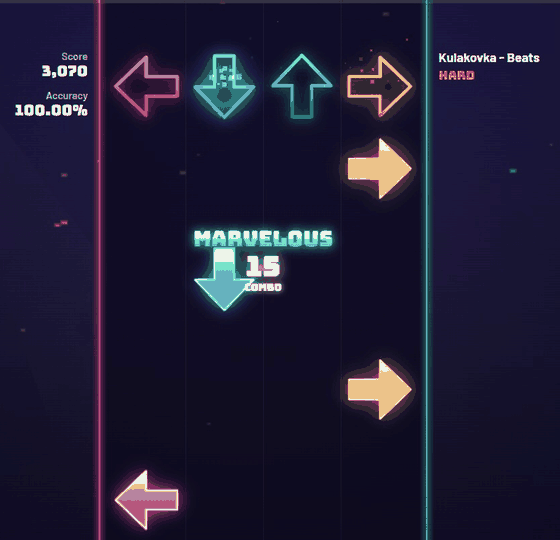
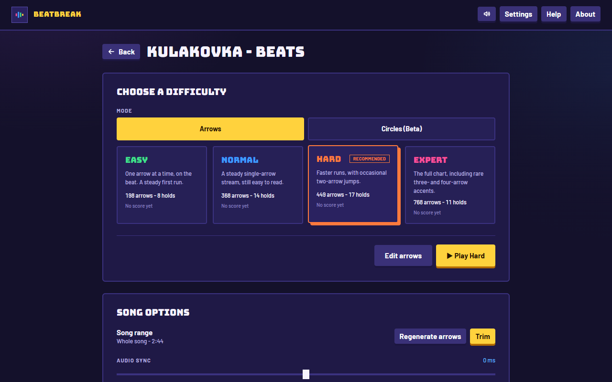
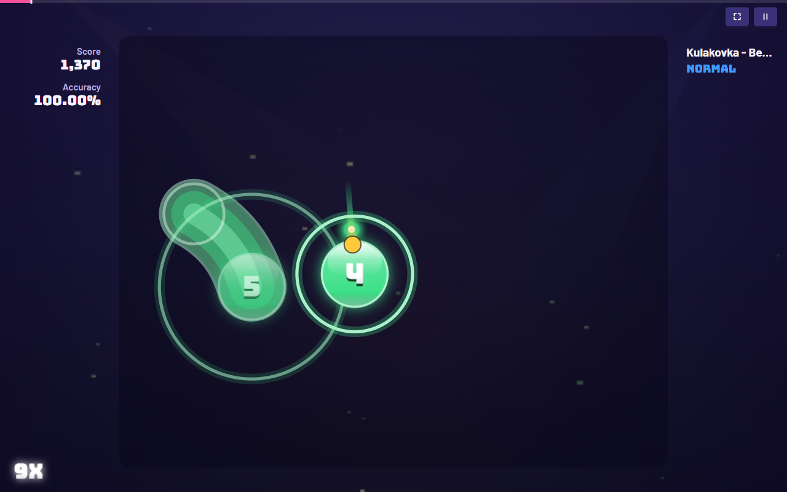
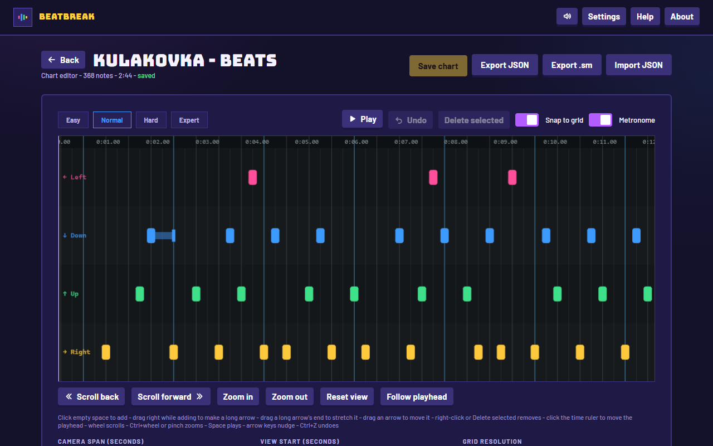
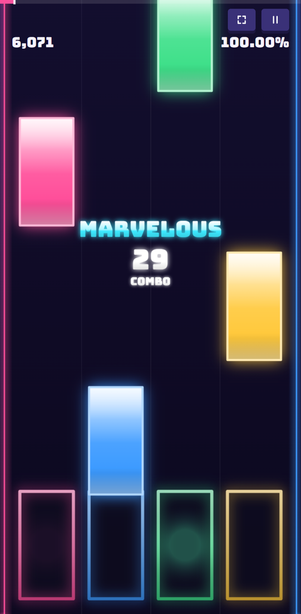

# Beatbreak

A rhythm game that builds its levels from your own music. Drop in an audio file and the browser works out the tempo and the beats, then writes four difficulties of arrow charts, plus an osu!-style circles mode. Nothing is uploaded and there is no account.

[Play it](https://beatbreak.vercel.app/)

[](https://github.com/amrogad/beatbreak/actions/workflows/ci.yml)



## From an audio file to a chart

The whole pipeline runs on the device, in a Web Worker so the page never freezes:

1. Decode the file with the Web Audio API and split it into frequency bands.
2. Find the tempo and where the beat falls, checking the result against repeating bars so a song isn't stuck at half or double speed.
3. Pick out the hits in each band (kick, snare, hats) and the sounds that ring on, which become long arrows.
4. Generate Easy, Normal, Hard and Expert charts from that one analysis. Lanes follow the instruments (bass leans left, hats lean right) and the patterns have to be playable: no jumps inside fast runs, rests after dense phrases, a cap of 12 arrows a second.

Charts are deterministic, so the same song gives the same arrows every time. I tuned the densities against human-made StepMania and osu!mania charts of 15 songs: on Easy, Normal and Hard, 84%, 83% and 79% of the generated arrows land on a moment the human charter also marked.

## Timing

A rhythm game is only as good as its timing, so judging uses each key press's event timestamp against the audio clock instead of the frame that happened to be drawn. Arrows use StepMania's hit windows and circles use osu!'s, so players coming from either game get what they expect. A tap-along calibration in Settings measures the delay of the player's speakers or headphones.

## Also here

- Circles mode (beta): the same rhythm laid out as osu!-style circles and sliders, with spacing based on human maps
- A chart editor for adding, moving and stretching arrows, with StepMania `.sm` and JSON export
- Phones get a touch layout with falling tiles
- Installable and works offline as a PWA; songs, charts and scores live in IndexedDB, with a backup file to move them to another device
- A canvas renderer that drops visual effects when frames run late, without ever touching judging

## Screenshots

| Song screen | Circles mode |
|---|---|
|  |  |

| Chart editor | Phone |
|---|---|
|  |  |

## Stack

React 18 and TypeScript (strict), built with Vite. Audio analysis, playback and drawing are written from scratch on the Web Audio API, Web Workers and Canvas 2D, with no game engine or audio library; the only runtime dependencies are React and two fonts.

247 Vitest tests cover tempo detection, chart rules, judging, scoring and storage migrations, and a smoke script runs the full pipeline on a generated song. GitHub Actions runs lint, type checks, tests, the smoke run and a production build on every push.

## Run it

```bash
npm install
npm run dev        # http://localhost:5173
npm test
```

## Limitations

- The analysis is heuristic. Songs with tempo changes or very quiet drums can get a tempo that is off, which the editor can correct.
- No mines, rolls, BPM changes or stops.
- Bluetooth audio adds delay. Calibration offsets it, but wired output is steadier.

## Credits

Menu music: [No Copyright Music](https://pixabay.com/music/beats-no-copyright-music-270241/) by Kulakovka, from Pixabay. Timing windows and hold rules follow the [StepMania](https://github.com/stepmania/stepmania) source and osu!'s published formulas; no code was copied.
